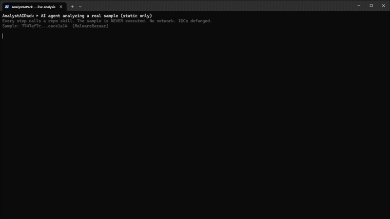

# AnalystAIPack

[](https://github.com/meltedinhex/analyst-ai-pack/actions/workflows/ci.yml)
[](LICENSE)
[](CATALOG.md)
[](https://agentskills.io)

**An open agent-skills library for malware analysis, reverse engineering, and threat hunting.**

AnalystAIPack gives an AI agent the working knowledge of a malware analyst and threat hunter:
which Volatility 3 plugin to run on a memory image, how to unpack a packed sample, how to
hunt C2 beaconing in network logs, and how to turn findings into YARA and Sigma. It is a
**focused, depth-first** library — 118 curated skills across four tightly-scoped subdomains,
where **every skill ships a tested, runnable analysis script**, not just prose.



> The name says what it is: a **pack** of ready-to-load **AI** agent skills for the security
> **analyst** — covering the full workflow to **hunt**, **reverse**, and **analyze** malicious
> code.

> **Independent project.** Not affiliated with Anthropic, MITRE, or any vendor named here.
> Built from scratch and synthesized from many primary sources; not copied from any other
> skills repository. See [CONTRIBUTING.md](CONTRIBUTING.md) for the sourcing and originality policy.
>
> **Personal work.** A personal, independent project maintained in a personal capacity. It is
> not affiliated with, endorsed by, or representative of the maintainer's employer.

## What makes it different

- **Depth over breadth.** Four deliberate subdomains (malware analysis, reverse engineering,
  threat hunting, and shared lab foundations) instead of a sprawling catalog — every skill is
  curated for the analyst's real workflow.
- **Every skill is runnable.** All 118 skills ship a tested `scripts/analyst.py` (standard
  library only, optional deps degrade gracefully) plus a repo-addwide smoke-test harness and CI
  `--check` gates — so the tooling actually works, not just reads well.
- **Safe by construction.** Scripts perform static, read-only analysis and **never execute the
  sample**; IOCs are defanged in output; sample-handling skills carry an explicit
  `Safety & Handling` section.
- **A defender's framework lens.** Skills map to **MITRE ATT&CK**, **MITRE D3FEND**, and
  **MITRE CAR** — chosen because they fit RE / malware analysis / threat hunting far better than
  compliance checklists.
- **Consistent, opinionated shape.** Each skill follows the same body contract — *When to Use*
  (with an explicit **Do not use**), *Workflow*, *Validation*, and *Pitfalls* — so an agent
  always knows the boundaries.

## Scope

Three pillars plus a shared foundation:

| Subdomain | What it covers |
|---|---|
| `lab-foundations` | Safe handling, lab setup, triage, hashing, file ID, IOC formats, reporting |
| `malware-analysis` | Static, dynamic, behavioral, and memory analysis; document/script malware; families |
| `reverse-engineering` | Disassembly/decompilation, unpacking, deobfuscation, anti-analysis defeat, language-specific RE |
| `threat-hunting` | Hypothesis-driven hunts, endpoint/network/identity telemetry, detection engineering |

See [taxonomy.md](taxonomy.md) for naming rules and framework mappings. Browse every skill in
[CATALOG.md](CATALOG.md), and see ATT&CK coverage in
[mappings/](mappings/README.md).

## Who it's for

- **SOC analysts & incident responders** — triage an unknown file, pull IOCs, and pivot them
  across telemetry without re-deriving the steps each time.
- **Malware analysts & reverse engineers** — a consistent procedure (and a runnable script)
  for static analysis, unpacking, config extraction, and language-specific RE.
- **Threat hunters & detection engineers** — turn a finding into a Sigma / YARA / Suricata
  detection and validate coverage against ATT&CK.
- **AI-agent builders** — drop a vetted, safety-bounded security skill set into Claude Code,
  Copilot, Cursor, or any agentskills.io-compatible agent.

## A worked example: from sample to detection

Each skill is a step; chained together they cover the full analyst loop. A typical
investigation of a suspicious executable walks through skills like these:

| # | Stage | Skill |
|---|---|---|
| 1 | Triage the unknown file | [`triaging-an-unknown-sample`](skills/triaging-an-unknown-sample/SKILL.md) |
| 2 | Static PE inspection | [`performing-static-pe-analysis`](skills/performing-static-pe-analysis/SKILL.md) |
| 3 | Spot packing via entropy | [`measuring-section-entropy-to-detect-packing`](skills/measuring-section-entropy-to-detect-packing/SKILL.md) |
| 4 | Unpack to the OEP | [`manually-unpacking-a-packed-binary`](skills/manually-unpacking-a-packed-binary/SKILL.md) |
| 5 | Recover the C2 config | [`extracting-cobalt-strike-beacon-config`](skills/extracting-cobalt-strike-beacon-config/SKILL.md) |
| 6 | Defang and package IOCs | [`defanging-and-sharing-iocs`](skills/defanging-and-sharing-iocs/SKILL.md) |
| 7 | Hunt the IOCs in traffic | [`hunting-cobalt-strike-traffic`](skills/hunting-cobalt-strike-traffic/SKILL.md) |
| 8 | Write a durable detection | [`writing-sigma-detection-rules`](skills/writing-sigma-detection-rules/SKILL.md) |

Driven directly from the CLI, the mechanical steps look like this:

```bash
# 1. Triage, then 5. recover the beacon config (read-only, never executes the sample)
python tools/analyst-pack.py run triaging-an-unknown-sample -- triage suspicious.exe
python tools/analyst-pack.py run extracting-cobalt-strike-beacon-config -- parse beacon.bin

# 7. Hunt the recovered indicators in proxy/Zeek logs, 8. emit a Sigma rule
python tools/analyst-pack.py run hunting-cobalt-strike-traffic -- hunt http.csv
```

Every script prints structured, **defanged** JSON you can feed into a report, a SIEM, or the
next skill in the chain.

## Format

Every skill follows the [agentskills.io](https://agentskills.io) `SKILL.md` standard, so it
works in Claude Code, GitHub Copilot, Cursor, Codex CLI, Gemini CLI, and other compatible
agents.

```
skills/<skill-name>/
├── SKILL.md                  # frontmatter + procedure (When to Use, Workflow, ...)
├── scripts/analyst.py        # runnable tooling
├── references/api-reference.md
└── LICENSE
```

Skills map to **MITRE ATT&CK**, **MITRE D3FEND**, and **MITRE CAR** (for hunts) in
frontmatter — frameworks chosen because they fit reverse engineering, malware analysis, and
threat hunting better than compliance checklists.

## Quick start

```bash
git clone https://github.com/meltedinhex/analyst-ai-pack.git
cd analyst-ai-pack

# Validate skills and (re)build the catalog
python tools/lint-skills.py --all
python tools/build-index.py

# (Re)build the browsable catalog and ATT&CK Navigator layer
python tools/build-catalog.py
python tools/build-navigator-layer.py
```

Point your agent at the `skills/` directory, or load an individual `SKILL.md`. AI agents
should read [AGENTS.md](AGENTS.md) first — it explains how to find, run, and safely chain
skills.

## Use with GitHub Copilot

Open this folder in VS Code. Copilot Chat automatically reads
[`.github/copilot-instructions.md`](.github/copilot-instructions.md), so it knows the skills
exist and how to run them safely. Then, in **Agent** mode, just ask:

- *"Hunt for LOLBin abuse in events.csv"* → uses `hunting-lolbin-abuse-on-windows`
- *"Triage this unknown file and pull IOCs"* → chains triage → IOC extraction

You can also point Copilot at a specific skill:

```
#file:skills/extracting-cobalt-strike-beacon-config/SKILL.md
Use this skill to analyze beacon.bin
```

No subscription beyond Copilot is required — the scripts are plain Python and run via Copilot's
terminal tool (or directly with `python tools/analyst-pack.py run …`).

## The `analyst-pack` CLI

A single front door to discover and run the library — unique to AnalystAIPack:

```bash
python tools/analyst-pack.py list --subdomain threat-hunting   # browse skills
python tools/analyst-pack.py search kerberos                   # full-text search
python tools/analyst-pack.py show hunting-lolbin-abuse-on-windows
python tools/analyst-pack.py run identifying-cryptographic-routines-in-binaries -- scan a.bin
python tools/analyst-pack.py stats                             # library statistics
python tools/analyst-pack.py lint                              # lint every skill
python tools/analyst-pack.py build                             # rebuild index/catalog/layer
```

## Creating a skill

```bash
# Copy the scaffold
cp -r templates/skill-template skills/my-new-skill   # PowerShell: Copy-Item -Recurse

# Edit SKILL.md, scripts/analyst.py, references/api-reference.md, then:
python tools/lint-skills.py skills/my-new-skill
python tools/build-index.py
```

Read [CONTRIBUTING.md](CONTRIBUTING.md) first — it covers the authoring checklist and the
originality rules that keep AnalystAIPack's content genuinely its own.

## Safety

These skills involve real malicious-code techniques. Sample-handling skills assume an
isolated analysis lab and document safe handling, encrypted storage, and IOC defanging.
AnalystAIPack ships **no live malware samples**. See [SECURITY.md](SECURITY.md).

## License

Apache-2.0 — see [LICENSE](LICENSE). MITRE ATT&CK, D3FEND, and CAR are © MITRE and used
under their respective terms.

---

Built and maintained by [meltedinhex](https://meltedinhex.com/) — malware analysis, reverse
engineering, and threat-hunting notes.
